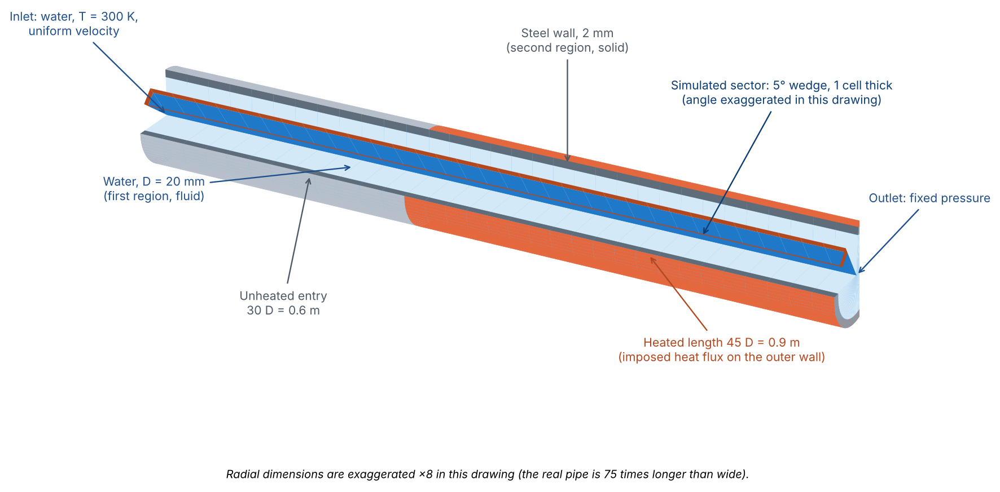
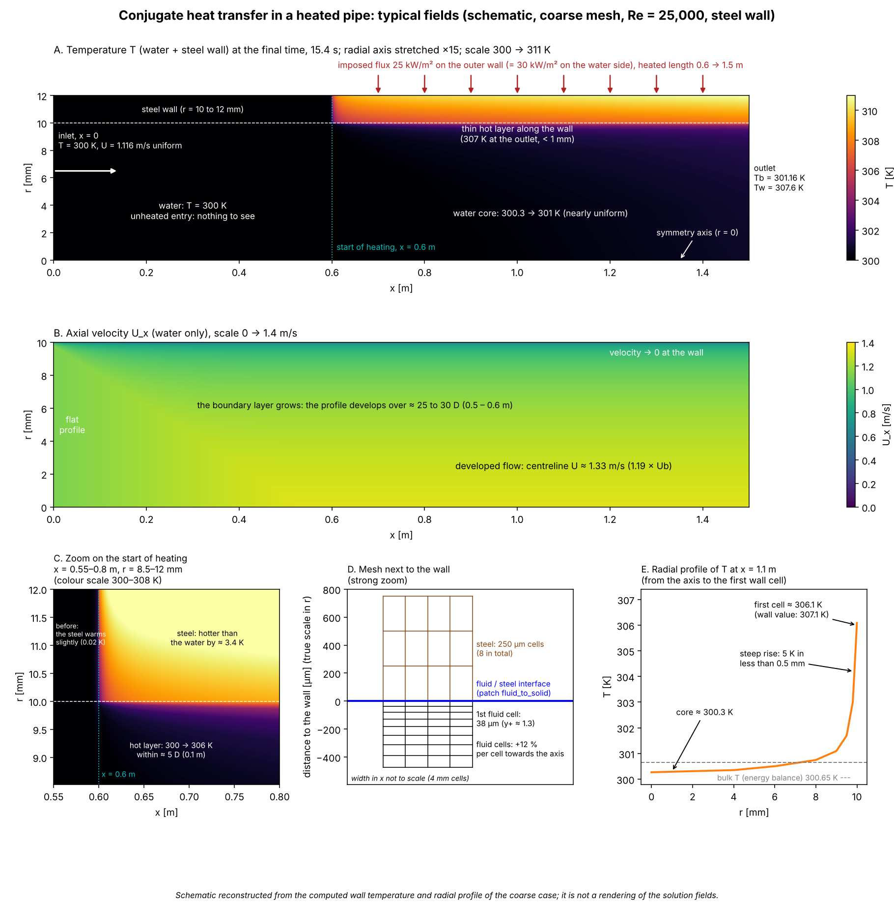
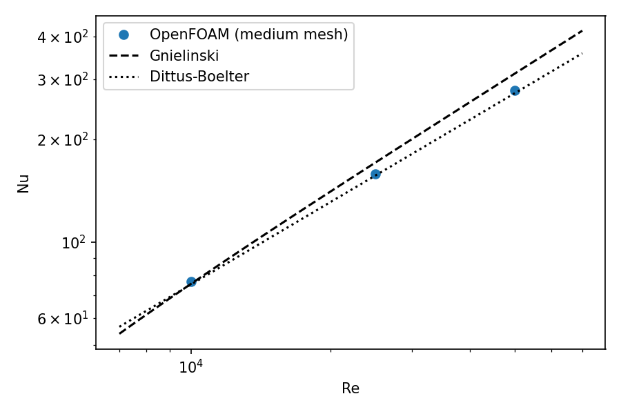
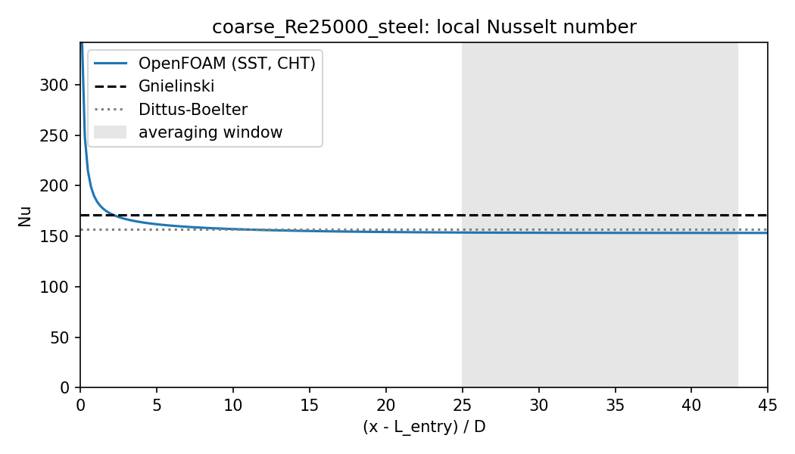
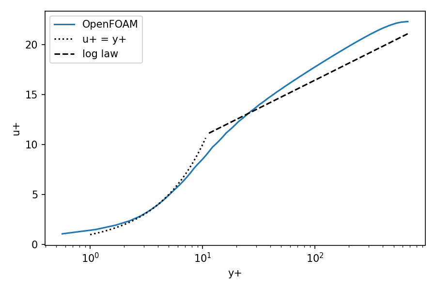
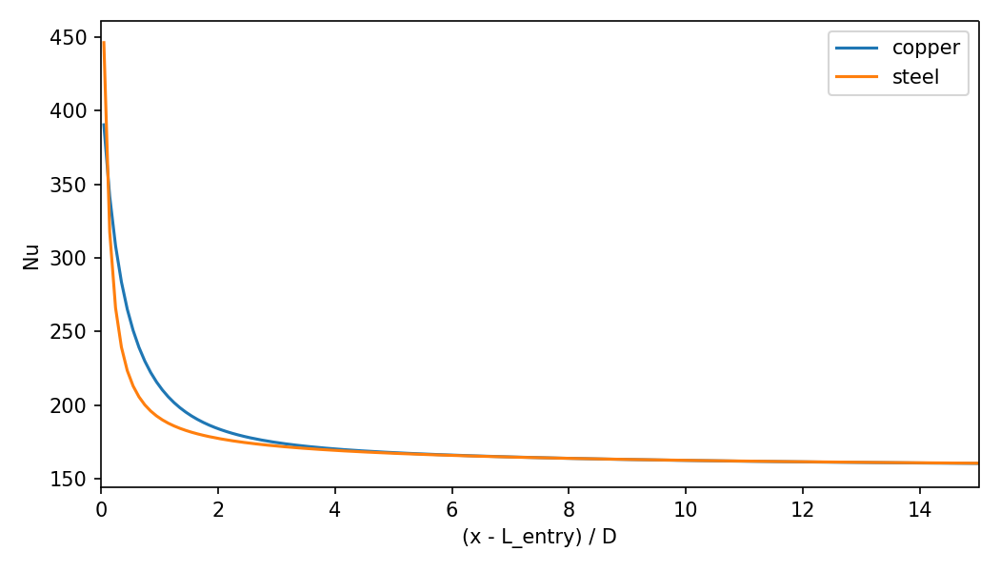

# Conjugate heat transfer in a heated pipe (OpenFOAM v2512)

Verification and validation of turbulent forced convection in a circular pipe with a conducting wall,
solved with `chtMultiRegionFoam` (fluid region + solid region, k-omega SST). The Nusselt number and the friction
factor are compared with classical correlations (Gnielinski, Dittus-Boelter, Petukhov), the energy balance is
checked, and the effect of the Reynolds number, of the mesh and of the wall material is documented.

Target: OpenFOAM v2512 (ESI / openfoam.com). Case generation and analysis: Python. Field visualisation: ParaView.

<p align="center">
  
</p>

*Simulated problem: a water pipe (D = 20 mm) with a 2 mm steel wall, heated on the outer surface over its last 45 D. Only a
5 degree sector, one cell thick, is meshed (axisymmetric wedge). The drawing exaggerates the radial dimensions.*

<p align="center">
  
</p>

*Typical fields (schematic, coarse mesh, Re = 25 000). The temperature and velocity maps are drawn from the computed wall
temperature, the computed radial profile shape and standard turbulent profiles; they are not renderings of the solution fields.*

## Status

| item | status |
|---|---|
| case generator, templates, analysis, tests (51 tests, no OpenFOAM needed) | done |
| coarse mesh, Re = 25 000, steel | done |
| medium mesh, Re = 10 000 / 25 000 / 50 000 (steel) and Re = 25 000 (copper) | done |
| fine mesh, Re = 25 000, steel | **attempted and stopped**: the transient run became unstable (see Limitations) |
| grid convergence index (GCI, needs three meshes) | **not available**; see "Mesh sensitivity" |

## Physical problem

| item | value |
|---|---|
| geometry | axisymmetric wedge (5 deg), inner diameter D = 20 mm, wall thickness 2 mm |
| lengths | 30 D unheated entry + 45 D heated, total 1.5 m |
| fluid | water, constant properties: rho = 997 kg/m3, mu = 8.9e-4 Pa s, Cp = 4180 J/kg/K, kappa = 0.607 W/m/K (Pr = 6.13) |
| wall | stainless-steel-like (kappa = 16, rho = 8000, Cp = 500) or copper-like (kappa = 400, rho = 8960, Cp = 385) |
| load | uniform heat flux q_i = 30 kW/m2 through the inner wall, imposed on the outer wall as q_o = q_i R_i / R_o (heated length only) |
| inlet | uniform velocity U_b = Re mu / (rho D), T = 300 K, turbulence intensity 5 %, mixing length 0.07 D |
| outlet | fixed pressure |
| turbulence | k-omega SST, `nutUSpaldingWallFunction`, `omegaWallFunction`, Jayatilleke thermal wall function (Pr_t = 0.85) |
| gravity | neglected (forced convection) |

Properties are constant: the study separates numerical and modelling errors from property variation.

## Quantities compared

- Local Nusselt number `Nu(x) = q_i D / (kappa_f (T_w(x) - T_b(x)))`, with `T_b(x)` from the global energy balance and
  `T_w` the fluid-side interface temperature; mean over the developed window `25 D <= x - L_entry <= 43 D`.
- Darcy friction factor from the pressure gradient (linear fit in the developed region).
- Energy balance: outlet mass-flow-weighted temperature versus `q_i pi D L_heated / (m_dot Cp)`.
- Steady state: outlet bulk temperature at 20 output times.
- Law of the wall: `u+` versus `y+` at x - L_entry = 30 D.

## Meshes

| mesh | cells (fluid + wall) | axial cells | radial cells (fluid / wall) | first cell | y+ at Re = 25 000 |
|---|---|---|---|---|---|
| coarse | 14 250 | 375 | 30 / 8 | 38 um | 1.27 |
| medium | 57 000 | 750 | 60 / 16 | 19 um | 0.66 |
| fine | 228 000 | 1500 | 120 / 32 | 9.7 um | 0.33 (expected) |

Each count doubles from one level to the next, with the same radial grading (ratio 30 between the largest and the smallest
fluid cell), so the three meshes are geometrically similar.

## Results

| case | cells | y+ (1st cell) | Nu | Nu Gnielinski | err % | Nu Dittus-Boelter | err % | f | f Petukhov | err % | energy balance % |
|---|---|---|---|---|---|---|---|---|---|---|---|
| coarse, Re 25 000, steel | 14 250 | 1.27 | 153.4 | 171.0 | -10.3 | 156.7 | -2.1 | 0.0229 | 0.0247 | -7.2 | -0.14 |
| medium, Re 10 000, steel | 57 000 | 0.30 | 76.9 | 75.6 | +1.7 | 75.3 | +2.1 | 0.0319 | 0.0315 | +1.3 | +0.02 |
| medium, Re 25 000, steel | 57 000 | 0.66 | 158.6 | 171.0 | -7.2 | 156.7 | +1.2 | 0.0238 | 0.0247 | -3.6 | -0.11 |
| medium, Re 25 000, copper | 57 000 | 0.66 | 158.4 | 171.0 | -7.4 | 156.7 | +1.1 | 0.0238 | 0.0247 | -3.6 | +0.03 |
| medium, Re 50 000, steel | 57 000 | 1.20 | 278.1 | 311.3 | -10.7 | 272.8 | +2.0 | 0.0198 | 0.0210 | -5.7 | -0.27 |





### What the results show

- **Scaling with Re.** Between Re = 10 000, 25 000 and 50 000 the computed Nu increases with an exponent of 0.79 and 0.81,
  the exponent of the Dittus-Boelter correlation (0.8). The medium-mesh results stay within +1 to +2 % of Dittus-Boelter at the
  three Reynolds numbers.
- **Comparison with Gnielinski.** The difference grows with Re: +1.7 %, -7.2 %, -10.7 %. Gnielinski and Dittus-Boelter differ by
  about 9 % from each other at Re = 25 000, so the reference itself carries a spread of that order.
- **Conservation.** The energy balance closes within 0.3 % in all cases (the wedge model has its own geometric offset of about
  0.1 %, because its inlet section is a flat triangle).
- **Wall material.** The developed Nu is the same for steel and copper (158.6 and 158.4, 0.1 % apart), as expected for a uniform
  flux. The wall changes the entry region only: the Nu peak at the start of heating is lower with copper (about 390 against
  447) and Nu is higher with copper between 0.3 and 8 D; the two curves merge at about 10 D.
- **Law of the wall.** The velocity profile follows `u+ = y+` in the viscous sublayer, crosses the logarithmic law near
  `y+ = 25` and shows the usual wake above it; the centreline velocity is about 1.19 times the bulk velocity
  (coarse mesh, Re = 25 000).





### Mesh sensitivity (two meshes, not a GCI)

From the coarse to the medium mesh at Re = 25 000 (steel), Nu increases by 3.4 % (153.4 to 158.6) and f by 3.9 %
(0.0229 to 0.0238). The Nu error with respect to Gnielinski also seems to track the near-wall resolution: -10 % at
y+ = 1.2--1.3 (coarse mesh; medium mesh at Re = 50 000), -7 % at y+ = 0.66, +1.7 % at y+ = 0.3. This is a hypothesis: the
thermal sublayer of water (Pr = 6) is thinner than the viscous sublayer, so a first cell at y+ close to 1 may not be fine enough
for the wall heat flux. It was not tested, since the run on the fine mesh (y+ = 0.33) did not stay stable.

With two meshes only a grid convergence index cannot be computed. A Richardson extrapolation with an *assumed* order p gives
indicative values: Nu = 163.8 for p = 1 and 160.3 for p = 2 (Gnielinski: 171.0; Dittus-Boelter: 156.7), and
f = 0.0247 for p = 1 and 0.0241 for p = 2 (Petukhov: 0.0247). These numbers show the size of the remaining discretisation
uncertainty, not a result.

## Limitations

- **No grid convergence index.** The fine-mesh run (228 000 cells) was started with the transient solver and stopped after 5.3 hours
  of computation, at t = 1.05 s of the 15.4 s planned. Already during the first 5 ms of simulated time the fluid temperature fell
  below the inlet temperature (300 K), reaching 299.0 K later, and the pressure equation did not converge (initial residuals of
  0.3--0.6 at every step, 1000 iterations of the multigrid solver). The instability therefore seems to originate in the start-up
  (uniform initial velocity, very thin wall cells) rather than in the later evolution. The result was discarded.
- **Re = 50 000: damped approach to steady state.** The outlet bulk temperature overshoots its steady value by about 2 % of the
  temperature rise around t = 7--7.6 s and decays afterwards; at the last output time it is within 0.3 % of the energy balance.
  The run ended before its last output interval; the resulting uncertainty on Nu is estimated below 0.5 %.
- Constant fluid properties; no buoyancy; axisymmetric (no azimuthal effects).
- Prandtl number of turbulence fixed at 0.85; no sensitivity study.
- Uniform inlet velocity (development length of 30 D before heating).
- The p_rgh solver tolerance was relaxed from 1e-9 to 1e-7 after the coarse case (small effect; continuity errors stay near 1e-12).
- Reference correlations are for smooth pipes and fully developed flow; Dittus-Boelter has a scatter of about 15--20 %.

## Perspectives

1. Steady-state formulation with `chtMultiRegionSimpleFoam` for the three-mesh study: no transient, much cheaper, same physics.
2. Fine mesh (or a radial-only refinement) with a gentler start-up (ramped inlet velocity, smaller initial time step or an initial field taken from the medium mesh) or with the steady solver, to test the y+ hypothesis and compute the GCI.
3. Sensitivity to the turbulent Prandtl number and to the thermal wall function.
4. Temperature-dependent water properties.
5. Comparison with measurements on a heat-exchange bench.

## Repository layout

```
template/            OpenFOAM case template (placeholders @@NAME@@)
src/chtpipe/         case generator, blockMesh writer, post-processing, GCI
scripts/             command-line tools and run scripts
tests/               pytest (mesh geometry, case generation, analysis on synthetic data)
docs/paraview.md     field visualisation checklist
docs/figures/        figures used in this README (geometry_3d.png, fields_schematic.png: scripts/make_readme_figures.py)
runs/                generated cases (git-ignored)
results/             analysis output (git-ignored)
```

## Quick start

```bash
# OpenFOAM v2512 sourced (WM_PROJECT_DIR set), then:
python3 -m venv .venv && . .venv/bin/activate
pip install -e ".[test]"
pytest                                   # no OpenFOAM needed

scripts/run_case.sh coarse 25000 steel 1       # generate, mesh, run, post-process one case
NP=4 scripts/run_queue.sh                      # the other medium cases (existing cases are skipped)
python3 scripts/summarize.py results           # summary table and figures
```

Step by step, for one case:

```bash
python3 scripts/make_case.py --mesh medium --re 25000 --wall steel --np 4
runs/medium_Re25000_steel/Allrun
scripts/post_case.sh runs/medium_Re25000_steel
```

The number of MPI processes is set with `--np` (default: 1 / 4 / 4 for coarse / medium / fine). To use more processes than
physical cores: `MPI_EXTRA_OPTS="--oversubscribe"`.

Outputs per case in `results/<case>/`: `summary.json`, `Nu_x.csv`, `Nu_x.png`, `T_wall_bulk.png`, `T_profiles.png`,
`u_plus.png`, `outlet_Tb_history.png`.

## License

MIT, see `LICENSE`. OpenFOAM is a separate project distributed under the GPL.
